<!-- Cards in assets/ are generated by scripts/build-cards.mjs and refreshed daily by .github/workflows/cards.yml -->

  

  
  
  
  
  
  


I build intentional, privacy-respecting systems. My work spans **deep reinforcement learning**, **graph-hybrid architectures** and **full-stack development** — a DQN that cuts median traffic wait times by about 80%, a predictive autoscaler that took Best Paper at ICRACE 2026, a recommender that explains itself. I care about digital ethics and code that solves real human problems.

## 💼 Experience & Education


## 🏆 Achievements


## 🛠️ Featured Projects

  <a href="https://github.com/Paradox-73/Enable_Native_SSO_in_eSignet_Go_for_Mobile_Apps"></a>
  <a href="https://github.com/Paradox-73/Predictive-Auto-Scaling-of-Dockerized-ML-Applications"></a>
  <a href="https://github.com/Paradox-73/Personal_Media_Intelligence_Hub"></a>
  <a href="https://github.com/Paradox-73/FedTraffic-RL"></a>
  <a href="https://github.com/Paradox-73/MusicBucket"></a>
  <a href="https://github.com/Paradox-73/PokerBots"></a>

  More: <a href="https://github.com/Paradox-73/DeepFake_Hackathon">DeepFake Detector</a> ·
  <a href="https://github.com/Paradox-73/Provenance">Provenance</a> ·
  <a href="https://github.com/Paradox-73/Whatsapp-Chat-Analyzer">WhatsApp Chat Analyzer</a> ·
  <a href="https://github.com/Paradox-73/Face_Liveness_Detection_and_Presentation_Attack_Detection">Face Liveness Detection</a> ·
  <a href="https://github.com/Paradox-73?tab=repositories">all repositories →</a>

## 💻 Tech Stack

**Languages** 
       

**Machine Learning** 
       

**Data & Infra** 
      

**Web** 
       


## 📊 GitHub by the Numbers


## 🏙️ Contribution Skyline


## 📼 Commit Mixtape


  

